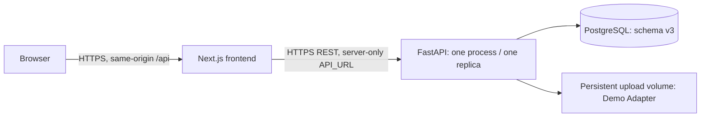

# Deploying the synthetic ClaimGuard prototype

No product features or claim rules were added. SQLite remains the recoverable development default. PostgreSQL verification is recorded in [POSTGRES_MIGRATION.md](POSTGRES_MIGRATION.md); public deployment is a separate verification gate.

## Architecture



Docker locally uses HTTP on loopback ports 3100/8100/15432. Cloud hosts must terminate HTTPS; do not claim the local container test verifies public TLS. The browser uses `/api`, retaining the existing Next rewrite. Set **server-only `API_URL` at frontend build time**, then rebuild/redeploy if the backend origin changes. No `NEXT_PUBLIC_API_BASE_URL` is needed. Never copy `DATABASE_URL` or the reset key into frontend environment variables, image build arguments or browser code.

## Reproducible Docker startup

Docker Desktop must be running. From the repository root, generate an ignored `deploy.env` once (do not overwrite a file whose password is already used by a persistent database):

```powershell
python -c "import secrets; from pathlib import Path; p=Path('deploy.env'); assert not p.exists(), 'deploy.env already exists'; p.write_text('POSTGRES_PASSWORD='+secrets.token_hex(24)+'\nDEMO_RESET_KEY='+secrets.token_hex(32)+'\n', encoding='utf-8')"
docker compose --env-file deploy.env -p claimguard-deploy build
docker compose --env-file deploy.env -p claimguard-deploy up -d --wait postgres
docker compose --env-file deploy.env -p claimguard-deploy run --rm backend python manage.py migrate
docker compose --env-file deploy.env -p claimguard-deploy run --rm backend python manage.py seed
docker compose --env-file deploy.env -p claimguard-deploy up -d --wait
```

Open `http://127.0.0.1:3100/dashboard`. API liveness: `http://127.0.0.1:8100/health`; database/schema readiness: `/ready`. Normal production startup checks schema/connectivity and marks interrupted jobs failed; it **does not migrate, seed or reset**. Development startup retains the accepted automatic migrate/idempotent seed behavior. `manage.py migrate`, `seed`, and `reset-demo` are distinct explicit administration commands; a seed is not a reset.

Read-only presenter preflight:

```powershell
powershell.exe -NoProfile -ExecutionPolicy Bypass -File .\preflight-demo.ps1 -FrontendUrl http://127.0.0.1:3100 -BackendUrl http://127.0.0.1:8100
```

Reset through container administration (access to Docker is privileged):

```powershell
docker compose --env-file deploy.env -p claimguard-deploy exec -T backend python manage.py reset-demo
```

Alternatively set `DEMO_RESET_KEY` in the presenter's shell from a password manager/secret store and use:

```powershell
powershell.exe -NoProfile -ExecutionPolicy Bypass -File .\reset-demo.ps1 -BackendUrl https://YOUR-BACKEND-DOMAIN
```

The production API requires **both** a permitted demo role and `X-Demo-Reset-Key`. Both reset endpoints reject missing/wrong keys. The normal public browser never receives the key; its reset action returns an explanatory 403. Use the presenter script for deployed reset. There is no generic database-wipe endpoint. Reset restores only the demo organization/scenarios and archives imported synthetic claims and prior history. It refuses active analysis jobs.

## Required and optional environment variables

| Service / variable | Use | Secret? |
|---|---|---|
| Frontend `API_URL` | Required deployed backend HTTPS origin, without `/api`; captured by build; local default `http://127.0.0.1:8000` | No, origin only; server-only |
| Backend `DATABASE_URL` | Required production PostgreSQL connection string; `postgres://`, `postgresql://`, `postgresql+psycopg://` accepted; preserve provider TLS parameters | **Yes** |
| Backend `APP_ENV` | `production` separates startup from bootstrap; local default `development` | No |
| Backend `ALLOWED_ORIGINS` | Required production comma-separated exact frontend origins; no wildcard | No |
| Backend `DEMO_MODE` | `true` for this synthetic pilot; `false` disables demo login/reset, without supplying enterprise auth | No |
| Backend `DEMO_RESET_KEY` | Required production demo secret of at least 32 characters; also enables protection in development when set | **Yes** |
| Backend `UPLOAD_DIR` | Optional configured persistent mount; default backend/storage, Docker `/data/uploads` | No |
| Backend `HOST`, `PORT` | Runner bind; Docker `0.0.0.0`, `8000`; respect host-provided PORT | No |
| Compose `POSTGRES_PASSWORD` | Required to initialize local PostgreSQL and configure its backend connection | **Yes** |
| Test `CLAIMGUARD_TEST_DATABASE_URL` | Dedicated disposable PostgreSQL test database only; never a presentation/production database | **Yes** |
| Test `DEMO_FRONTEND_URL` | Browser test base URL; local default port 3000 | No |

Python reads process environment, not `.env` automatically. Compose reads `deploy.env`; Next reads its normal frontend `.env` files or build environment. `.env.example` contains placeholders only. No unused signing/SSO variables were invented.

## Cloud preparation: Vercel frontend and Render backend/database

No provider account credentials were found in the checked CLI/environment locations. No public URL is claimed. These steps require your provider account and an uploaded Git repository; the current workspace has no Git repository.

1. Create a private repository and upload source with `.gitignore` respected. Exclude `.env*`, `deploy.env`, databases, vendor/tools, node_modules, logs and runtime uploads. Verify exclusions before pushing.
2. Provision managed PostgreSQL in the backend region. Obtain its connection URL and required TLS parameters from the provider. Store it as backend `DATABASE_URL`, never frontend configuration. Do not share the local Docker database password.
3. Create a Render Docker web service with root directory `backend` and Dockerfile `Dockerfile`. Use one instance, one Uvicorn process, no reload. Configure `APP_ENV=production`, `DEMO_MODE=true`, generated `DEMO_RESET_KEY`, `DATABASE_URL`, `ALLOWED_ORIGINS=https://YOUR-FRONTEND-DOMAIN`, and `UPLOAD_DIR=/data/uploads`. Attach a persistent disk at `/data` where the selected host supports it. Configure health path `/ready`.
4. Configure the release/pre-deploy command `python manage.py migrate`. After initial successful migration/start, use the host's authenticated service shell to run **once** `python manage.py seed`. Check seed success and presenter preflight before judging. Future restarts/redeploys must not run reset. If the host has no pre-deploy/shell facility, execute these two commands as separate one-off containers with the same secrets/network access before normal startup.
5. Create the Vercel project with root directory `frontend`, install `npm ci`, build `npm run build`, Next.js framework. Set server-only `API_URL=https://YOUR-BACKEND-DOMAIN` before building. Do not deploy this app as a static export. After Vercel assigns the actual domain, set that exact origin in backend CORS and redeploy the backend; rebuild frontend if API_URL changes. Preview domains need explicit allowlisting when direct browser API access is used.
6. Confirm both public HTTPS URLs respond, then set the presenter reset key only in your shell. Run reset and preflight with the real public URLs, then the complete [judge sequence](JUDGE_DEMO.md) three consecutive times, including cited evidence, CG021 94% after refresh, audit/trace, mandatory human reason, knowledge, graph, FHIR and final reset to 63%. Do not substitute local verification for this gate.

Use the providers' current primary instructions: [Vercel environment configuration](https://vercel.com/docs/environment-variables), [Render web service configuration](https://render.com/docs/web-services), [FastAPI deployment](https://render.com/docs/deploy-fastapi) and [persistent disks](https://render.com/docs/disks). Disk-backed Render services have deployment/scale constraints; confirm the selected plan supports the required disk before relying on original upload retention. PostgreSQL configuration alone does not prove public deployment.

## Storage and authentication limits

Bundled synthetic evidence, governed passages, intake extraction text and FHIR evidence are persisted in PostgreSQL. The sample FHIR Bundle is bundled in the backend image. Runtime original upload bytes use the configurable LocalStorage interface with opaque keys. Compose's named upload volume persists across stop/start/recreate; cloud deployments need a persistent disk for equivalent retention. Without one, original upload bytes may disappear during redeploy even though extracted text remains in PostgreSQL. The four-minute sequence uses database evidence and a bundled FHIR sample, so it does not need runtime upload bytes; the separate intake demonstration does. No cloud object storage, malware scanning, encryption policy or signed-object delivery is claimed.

Demo sessions are random, process-local tokens. Public users can select demo roles freely; server-side role/org checks still enforce the selected role, but this is **prototype authentication, not verified user identity or SSO**. Only synthetic data belongs in this environment. The reset key protects reset only; it does not turn demo role selection into production identity. Sessions require role reconnection after restart. Jobs use one process and background tasks; interrupted work fails visibly and can be retried. Do not run multiple workers/replicas or promise simultaneous independent presentations. SQLAlchemy uses pre-ping, five pooled connections plus five overflow, ten-second pool wait and five-second connection timeout.

## Verification commands

```powershell
python backend/test.py
python backend/verify_postgres.py
python backend/verify_deployment.py
python backend/lint.py
npm.cmd run typecheck --prefix frontend
npm.cmd run lint --prefix frontend
npm.cmd run format:check --prefix frontend
```

The PostgreSQL scripts target the isolated local Compose deployment and read its ignored secrets file without printing values. The schema/test script creates and removes its own uniquely named database. It checks migration rollback, table/column types/nullability, primary/foreign keys, defaults and index inventory. All existing test assertions are preserved. One SQLite-labelled preflight test runs unchanged in the full SQLite suite; the PostgreSQL subset excludes only that test.

Run E2E **from the repository root**: existing fixtures read `backend/demo` relative to that directory. Load `DEMO_RESET_KEY` into the shell for authorized browser reset tests, then:

```powershell
$env:DEMO_FRONTEND_URL='http://127.0.0.1:3100'
npm.cmd exec --prefix frontend -- playwright test --config frontend/playwright.config.ts
```

Only the test process receives that secret header. It is not compiled into the frontend. Browser tests reset/mutate the synthetic presentation, so never target a non-demo environment.

The independently verified clean-start project uses fresh named volumes and ports 3101/8101/15433. After building the main images, run these commands (the override requires a Compose version supporting `!override`, verified with the installed version):

```powershell
docker compose --env-file deploy.env -p claimguard-clean -f compose.yaml -f compose.verify.yaml up -d --wait postgres
docker compose --env-file deploy.env -p claimguard-clean -f compose.yaml -f compose.verify.yaml run --rm backend python manage.py migrate
docker compose --env-file deploy.env -p claimguard-clean -f compose.yaml -f compose.verify.yaml run --rm backend python manage.py seed
docker compose --env-file deploy.env -p claimguard-clean -f compose.yaml -f compose.verify.yaml up -d --no-build --wait
powershell.exe -NoProfile -ExecutionPolicy Bypass -File .\preflight-demo.ps1 -FrontendUrl http://127.0.0.1:3101 -BackendUrl http://127.0.0.1:8101
```

Use a new project name for another genuinely fresh-volume run; an existing project intentionally keeps its database. The main deployment remains at ports 3100/8100. On Windows, add `--context desktop-linux` after `docker` if your selected context is not Docker Desktop's Linux engine.

## Troubleshooting and rollback

- `/health` means the process is live; `/ready` additionally checks PostgreSQL and schema v3; preflight additionally checks the 50 active claims, exact initial stories, knowledge and no active jobs. A resolved CG021 correctly makes initial-state preflight fail until explicit reset.
- Startup fails clearly for missing PostgreSQL, missing migrations, missing explicit production origins or a short/missing reset secret. Errors do not print connection strings. Structured events cover startup/connectivity, migrations, API status/failures, analysis and resolution/reset actions without request contents, passwords or tokens.
- A 403 reset needs the presenter key plus Claims Executive/Manager authorization. A 401 after restart needs a new role session. A 409 reset means wait for running jobs. Do not change assertions or clear the database to mask these conditions.
- Database access failures: confirm provider network/TLS, database credentials and readiness logs. Do not print DATABASE_URL into logs or browser debugging output. Migration failure is nonzero; repair the cause and rerun. PostgreSQL DDL and revision records roll back together.
- Port conflicts: Docker uses 3100/8100/15432, keeping the SQLite demo's 3000/8000 separate. Use `docker compose ... logs backend` / `logs frontend` and check identified processes. Do not kill unknown services.
- Roll back application images/release to the last verified commit/image. Current revisions are additive; no destructive downgrade script is supplied. Preserve PostgreSQL and upload volumes, take a provider backup before future schema changes, and test restore separately. **Do not use `down -v`** for application rollback.
- Recover the original local demo by leaving DATABASE_URL unset and APP_ENV at development, then run `start.ps1`, reset and preflight on ports 3000/8000. PostgreSQL containers use separate files/volumes; they do not overwrite the SQLite database.

Production identity, multi-replica concurrency, durable queues, backups/restore drills, load/security/clinical validation and live integrations remain future work. See [LIMITATIONS.md](LIMITATIONS.md) and [DEPLOYMENT_CHECKLIST.md](DEPLOYMENT_CHECKLIST.md).
