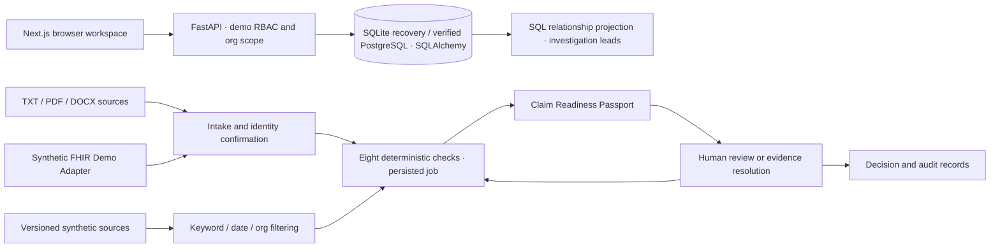

# ClaimGuard AI — technical defense

## Working architecture

| Judge question | Defensible answer |
|---|---|
| Why agents? | Named checks separate document reading, eligibility, evidence, policy, clinical consistency, billing, integrity and Passport preparation. Their inputs, tools, results and transitions can be inspected. This build uses deterministic check nodes, not live LLM agents. |
| Why LangGraph? | LangGraph is **not installed or used here**. Local Python orchestration and persisted AnalysisJob/AgentRun records provide the demonstrated sequence and retry behavior. A graph runtime is a possible future replacement when branching, durable workers and richer orchestration warrant it; no framework capability is claimed as delivered. |
| Why RAG? | Conclusions need applicable sources. The implemented retrieval layer filters by organization, active status and dates, then ranks keyword overlap and returns cited passages. It uses bounded rule-backed answers; no embedding service, vector database or generative RAG model is connected. |
| Why deterministic rules? | Presence, chronology, identity, totals and package inclusions should produce repeatable, reviewable checks. The scores and thresholds are prototype choices, not clinical or actuarial validation. |
| Why a knowledge graph? | Relationship exploration makes shared-source and provider patterns visible. The delivered graph is a deterministic SQL projection, not Neo4j. Its output is an investigation lead requiring verification. |
| Why web rather than mobile? | A claims desk needs readable sources, tables, review controls and printable evidence. Responsive layouts support smaller screens; mobile uses linked claims and signal cards instead of the full graph canvas. |
| Why not autonomous adjudication? | Evidence readiness and payer adjudication are different decisions. ClaimGuard prepares evidence, records human dispositions and preserves sources; it does not approve, deny or determine fraud. |
| How do you prevent hallucination? | This demo performs no unconstrained model generation. Applicable source checks and explicit hard gates govern results. Missing/unreadable evidence or unavailable policy produces human review or insufficient evidence. This does not prove a future LLM would be hallucination-free. |
| How do humans retain authority? | Reviewers inspect citations, then Agree, Override with a mandatory reason, Request Information or Escalate. Decisions are persisted with the original finding and evidence. Missing required operative evidence cannot be cleared using the billing override. |
| What actually works? | Local uploads/parsing, database persistence, checks, CG021 validation/targeted rerun, review, knowledge lookup, exports, SQL graph, narrow FHIR mapping and reset/recovery. Requests/responses and all policy/patient/provider material are synthetic. |
| How would NHCX integration work? | Replace the disconnected card with an approved, tested transport adapter; map internal data to the applicable supported profiles, validate against the required specifications, configure authenticated endpoints and consent/access controls, test acknowledgments/errors and complete sandbox/conformance work before claiming connectivity. None of that is connected in this release. |
| How would this scale? | Use the locally verified PostgreSQL path, move uploads to governed object storage, jobs to durable workers, and introduce tenant isolation, indexes, pagination, idempotency and operational monitoring. Load-test with realistic permitted datasets. No production scale claim follows from 50 cases. |
| What protects patient data? | The demo uses fictional data and local loopback services. Server-side role/org checks, constrained uploads, opaque storage keys, ORM queries and escaped HTML are implemented. Production identity, encryption, consent, retention, key management and security review are still required. |
| What is the moat? | A hypothesis: source-governed rules, resolution outcomes and defensible human review workflows could become a useful operational knowledge asset. This prototype has no validated competitive moat or production dataset advantage. |
| What needs production validation? | Policy interpretation, extraction/OCR, identity matching, clinical consistency, anomaly thresholds, score calibration, integrations, security, workflow outcomes and performance under representative load. |

## Persistence decision

**SQLite remains the local recovery path. PostgreSQL is verified locally in Docker:** schema v1-v3, transactional migration rollback, repeated seed/reset, backend/browser tests and CG021 94% surviving backend restart with equal history. Public managed PostgreSQL/HTTPS deployment remains unverified. See [POSTGRES_MIGRATION.md](POSTGRES_MIGRATION.md).

## Timing interpretation

`hardening/rehearsal-*.json` records browser action/load times on this machine. CG021 also records the actual deterministic targeted-check computation interval. Neither is model inference timing. There is no artificial processing sleep; 350 ms job polling is a UI refresh interval. The four-minute schedule includes explanation time; automated click runs omit narration.
